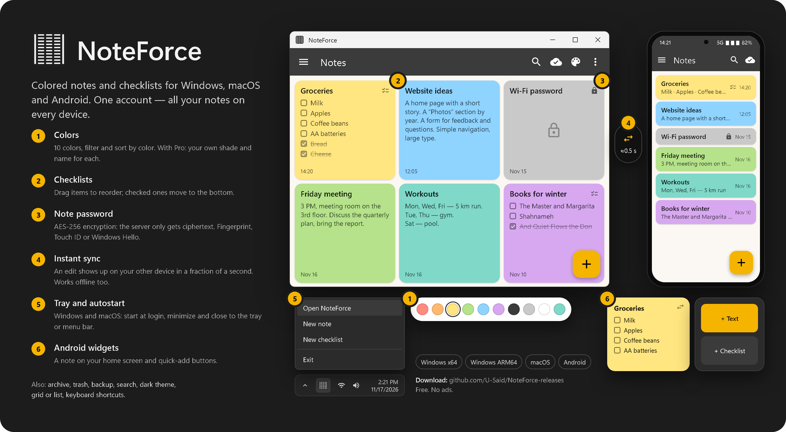

# NoteForce

Colored notes and checklists for Windows, macOS, Linux and Android. One account on all your devices, edits show up on the others within a couple of seconds. Free, no ads.

**Like NoteForce? [Support the project](https://app.lava.top/4179967925)** ([details](#support-the-project)) · [Русский ниже ↓](#русский)

## Download

| Platform | File |
|---|---|
| **Android** (almost every phone) | [NoteForce-arm64.apk](https://github.com/U-Said/NoteForce-releases/releases/latest/download/NoteForce-arm64.apk) |
| Android, universal | [NoteForce.apk](https://github.com/U-Said/NoteForce-releases/releases/latest/download/NoteForce.apk) |
| **Windows 10/11** (Intel/AMD) | [NoteForce-Windows.zip](https://github.com/U-Said/NoteForce-releases/releases/latest/download/NoteForce-Windows.zip) |
| **Windows 11 on ARM** (Snapdragon: Surface Pro 11/12, Copilot+ PCs) | [NoteForce-Windows-arm64.zip](https://github.com/U-Said/NoteForce-releases/releases/latest/download/NoteForce-Windows-arm64.zip) |
| **macOS 13 (Ventura) or later** (Apple Silicon and Intel) | [NoteForce-macOS.zip](https://github.com/U-Said/NoteForce-releases/releases/latest/download/NoteForce-macOS.zip) |
| **Linux** (x64, desktops with GTK 3: Ubuntu 22.04+, Debian 12+, Fedora, Mint 21+ and others) | [NoteForce-Linux.tar.gz](https://github.com/U-Said/NoteForce-releases/releases/latest/download/NoteForce-Linux.tar.gz) |

**Android users of version 1.5 or earlier:** version 1.6 has to be installed once from scratch — see [Install and update](#install-and-update).

The links always point to the latest version. All versions are in [Releases](https://github.com/U-Said/NoteForce-releases/releases).

**Windows via Microsoft Store:** [NoteForce: Fast Notes](https://apps.microsoft.com/detail/9PLPBDJND4GL), or in a terminal: `winget install 9PLPBDJND4GL`. The Store version is signed by Microsoft, so Windows shows no warning, and it updates by itself; new versions reach the Store a few days later than here.

## What the picture shows

1. **Colors.** 10 colors; notes can be filtered and sorted by color. With Pro, each of the 10 colors can get your own shade and name.
2. **Checklists.** Drag items to reorder; checked items move to the bottom. “Check all” and “Delete checked” are in the note’s ⋮ menu.
3. **Note password.** A locked note is encrypted on the device (AES-256-GCM); the server only receives ciphertext. You enter the password, a fingerprint (Android), Touch ID (Mac) or Windows Hello once: the note opens by itself as soon as the password is right. On a computer locked notes then stay open until you close the NoteForce window to the tray or quit the app (minimizing does not close them); on Android, until you leave the app.
4. **Instant sync.** An edit on one device appears on your other devices a couple of seconds after you stop typing. Offline everything works as usual, and changes are sent when you are back online.
5. **Tray and autostart (Windows and macOS).** NoteForce can start at login and live in the system tray or the Mac menu bar. Its menu creates a note or a checklist right away.
6. **Android widgets.** “Note” shows a chosen note on the home screen: tap a new widget to choose the note, the ⇄ button in the corner changes it. “Quick note” creates a text note or a checklist with one tap.

Also: undo and redo in a note (↶ ↷), archive, trash with restore, JSON backup, search across notes and inside a note, dark theme, grid or list view, English and Russian interface, and a detailed user guide in Settings.
Keyboard shortcuts on Windows and Linux (Ctrl) and Mac (⌘): N — new note, L — new checklist, F — search, S — save, Z — undo, Y (⇧⌘Z on Mac) — redo, Esc — close.

## NoteForce Pro

Everything above is free. Pro adds:

- **Color settings** — give any of the 10 colors your own shade (all notes of that color change on every device), a name (“Work”, “Home”, “Urgent”) that shows on cards, in the filter and in search, or remove colors you don’t use and add them back up to 10.
- **Spell check** — English and Russian at the same time; corrections with a right-click (Windows, Mac) or a tap (Android). Not available on Linux yet.
- **Reminders** — coming soon.

Pro is a one-time purchase — $5, €5 or 399 ₽ — for your account: forever and on all its devices.
**How to buy:** sign in, open the menu ☰ → **NoteForce Pro**, choose the currency and tap **Buy for …**. The payment page of lava.top opens in the browser: Russian bank cards pay in rubles, cards from other banks in dollars or euros. The purchase is tied to the email of your NoteForce account, and Pro turns on by itself: within seconds in the open app, and on your other devices as soon as they sync.

## Getting started

1. Install NoteForce on each device (see below).
2. On the first device open the menu ☰ → **Account and sync** → **Sign up**, enter an email and a password, then the 6-digit code from the email we send you.
3. On the other devices open the same screen, choose **Sign in** and enter the same email and password. Your notes appear by themselves.

Forgot your password? On the **Sign in** tab tap **Forgot password?** — a code from the email lets you set a new one. Your notes are kept.

Without an account NoteForce works too, but notes stay on that device only.

## Install and update

**Android.** Open the downloaded APK on the phone and allow installing from this source. If Google Play Protect warns about an unknown app, tap “More details” → “Install anyway”. A new version installs over the old one; notes are kept.

**Android: moving from 1.5 or earlier to 1.6 (once).** Starting with 1.6 NoteForce for Android is signed with a new permanent key, so Android cannot install it over an older version (“App not installed”). Before removing the old version: with an account, open ☰ → **Account and sync** and wait for “Synced”; without one, make a backup in Settings → **Export backup**. If you open locked notes with a fingerprint, make sure you remember the note password — fingerprint unlock is removed with the app and has to be turned on again. Then uninstall NoteForce, install 1.6 and sign in (or use Settings → **Import from backup**) — your notes come back. Home-screen widgets need to be added again, and app settings (theme, sorting, font size, language) return to defaults. Later versions install over 1.6 as usual.

**Windows.** Unzip the archive to any folder and run `NoteForce.exe`. The app is not code-signed yet, so on first launch Windows may show “Windows protected your PC” — click “More info” → “Run anyway”. To update, quit the app (if it is in the tray: tray icon → “Exit”) and unzip the new version over the old one.

**Windows on ARM (Snapdragon).** Download `NoteForce-Windows-arm64.zip`. A “Bad Image” error with code `0xc0e90002` means Smart App Control blocks unsigned apps; NoteForce can only run after you turn it off in Windows Security → App & browser control.

**macOS.** Unzip `NoteForce-macOS.zip` and move **NoteForce** to the Applications folder. NoteForce for Mac is not signed by Apple yet, so the first launch is blocked: open **System Settings → Privacy & Security**, scroll down and click **Open Anyway** next to NoteForce (on macOS 14 and earlier you can also right-click the app → Open). To update, quit NoteForce (⌘Q) and replace the app with the new one; if macOS blocks the first launch of the new version, click **Open Anyway** again.

**Linux.** Unpack `NoteForce-Linux.tar.gz`, move the **NoteForce** folder where you want to keep it (for example `~/Apps/NoteForce`) and run `./noteforce` from it; `./install.sh` adds NoteForce to the applications menu (no sudo). If it does not start, install libsecret: `sudo apt install libsecret-1-0` (Ubuntu, Debian, Mint) or `sudo dnf install libsecret` (Fedora). On Linux there is no tray icon (closing the window quits NoteForce) and no spell check yet. To update, replace the contents of the folder with the new version.

## Where your notes are stored

Every device keeps a full copy, so your notes are available offline. For sync a copy is stored on a Supabase server in Frankfurt; each account sees only its own notes. Locked notes reach the server already encrypted — without your password nobody can read them.

To delete your account and its notes from the server, open ☰ → **Account and sync** → **Delete account** — see [Delete your NoteForce account](DELETE-ACCOUNT.md). [Privacy Policy](PRIVACY.md).

## Support the project

NoteForce is free and has no ads. If it helps you, you can say thanks with a donation: **https://app.lava.top/4179967925** → “Send a donation”.

- Pick a preset amount ($5, $10, $50 or 50, 100, 500 ₽) or enter your own and leave a comment.
- Bank cards are accepted, including Russian ones (payment in rubles, SBP available), plus other methods the payment page offers.
- Payments go through lava.top. A donation is voluntary and non-refundable.

---

## Русский

Цветные заметки и чек-листы для Windows, macOS, Linux и Android. Один аккаунт на всех устройствах, правки видны на остальных через пару секунд. Бесплатно, без рекламы.

**Нравится NoteForce? [Поддержите проект донатом](https://app.lava.top/4179967925)** ([подробнее](#поддержать-проект))

### Скачать

| Платформа | Файл |
|---|---|
| **Android** (почти все телефоны) | [NoteForce-arm64.apk](https://github.com/U-Said/NoteForce-releases/releases/latest/download/NoteForce-arm64.apk) |
| Android, универсальный | [NoteForce.apk](https://github.com/U-Said/NoteForce-releases/releases/latest/download/NoteForce.apk) |
| **Windows 10/11** (Intel/AMD) | [NoteForce-Windows.zip](https://github.com/U-Said/NoteForce-releases/releases/latest/download/NoteForce-Windows.zip) |
| **Windows 11 на ARM** (Snapdragon: Surface Pro 11/12, Copilot+ PC) | [NoteForce-Windows-arm64.zip](https://github.com/U-Said/NoteForce-releases/releases/latest/download/NoteForce-Windows-arm64.zip) |
| **macOS 13 (Ventura) и новее** (Apple Silicon и Intel) | [NoteForce-macOS.zip](https://github.com/U-Said/NoteForce-releases/releases/latest/download/NoteForce-macOS.zip) |
| **Linux** (x64, рабочий стол с GTK 3: Ubuntu 22.04+, Debian 12+, Fedora, Mint 21+ и другие) | [NoteForce-Linux.tar.gz](https://github.com/U-Said/NoteForce-releases/releases/latest/download/NoteForce-Linux.tar.gz) |

**У кого на Android стоит версия 1.5 или более ранняя:** версию 1.6 нужно один раз установить заново — см. [Установка и обновление](#установка-и-обновление).

Ссылки всегда ведут на последнюю версию. Все версии лежат в разделе [Releases](https://github.com/U-Said/NoteForce-releases/releases).

**Windows через Microsoft Store:** [NoteForce: Fast Notes](https://apps.microsoft.com/detail/9PLPBDJND4GL) или командой в терминале: `winget install 9PLPBDJND4GL`. Версия из Store подписана Microsoft, поэтому Windows не показывает предупреждений, и обновляется сама; новые версии попадают туда на несколько дней позже, чем сюда.

### Что умеет NoteForce

1. **Цвета.** 10 цветов, заметки можно отфильтровать и отсортировать по цвету. С Pro у каждого из 10 цветов может быть свой оттенок и название.
2. **Чек-листы.** Пункты перетаскиваются, отмеченные уходят вниз. В меню ⋮ заметки есть «Отметить все» и «Удалить отмеченные».
3. **Пароль на заметки.** Содержимое заблокированной заметки шифруется на устройстве (AES-256-GCM), на сервер уходит только шифротекст. Пароль, отпечаток (Android), Touch ID (Mac) или Windows Hello вводится один раз: заметка открывается сама, как только пароль верный. Дальше на компьютере заблокированные заметки открываются без пароля, пока окно NoteForce не закрыто в трей или программа не завершена (сворачивание их не закрывает); на Android — пока вы не ушли из приложения.
4. **Мгновенная синхронизация.** Правка на одном устройстве появляется на остальных через пару секунд после того, как вы перестали печатать. Без интернета всё работает как обычно, а изменения уходят на сервер при подключении.
5. **Трей и автозапуск (Windows и macOS).** Программа может запускаться при входе в систему и жить в трее или строке меню Mac. Из её меню можно сразу создать заметку или чек-лист.
6. **Виджеты Android.** «Заметка» показывает выбранную заметку на рабочем столе: нажмите на новый виджет, чтобы выбрать её, а кнопкой ⇄ в углу смените. «Быстрая заметка» создаёт текст или чек-лист одним нажатием.

Ещё есть отмена и повтор правок в заметке (↶ ↷), архив, корзина с восстановлением, резервная копия в файл JSON, поиск по всем заметкам и внутри заметки, тёмная тема, вид сеткой или списком, английский и русский интерфейс и подробная инструкция в Настройках.
Горячие клавиши в Windows и Linux (Ctrl) и на Mac (⌘): N — новая заметка, L — новый чек-лист, F — поиск, S — сохранить, Z — отменить, Y (на Mac ⇧⌘Z) — повторить, Esc — закрыть.

### NoteForce Pro

Всё перечисленное выше бесплатно. Pro добавляет:

- **Настройки цветов** — любому из 10 цветов можно задать свой оттенок (все заметки этого цвета меняются на всех устройствах), название («Работа», «Дом», «Срочно»), которое видно на карточках, в фильтре и в поиске, или удалить ненужный цвет и снова добавлять цвета до 10.
- **Проверка орфографии** — русский и английский одновременно; варианты исправления по правой кнопке мыши (Windows, Mac) или нажатию (Android). В Linux пока недоступна.
- **Напоминания** — скоро.

Pro — разовая покупка (399 ₽, $5 или €5) на аккаунт, навсегда и на всех его устройствах.
**Как купить:** войдите в аккаунт, откройте меню ☰ → **NoteForce Pro**, выберите валюту и нажмите **Купить за …**. В браузере откроется страница оплаты lava.top: карты российских банков — в рублях, карты других банков — в долларах или евро. Покупка привязывается к почте вашего аккаунта NoteForce, и Pro включается сам: в открытой программе — за несколько секунд, на остальных устройствах — при ближайшей синхронизации.

### Как начать

1. Установите NoteForce на каждое устройство (инструкция ниже).
2. На первом устройстве откройте меню ☰ → **Аккаунт и синхронизация** → **Регистрация**, введите email и пароль, а затем код из 6 цифр из письма, которое мы пришлём.
3. На остальных устройствах откройте тот же экран, выберите **Вход** и введите те же данные. Заметки появятся сами.

Забыли пароль? На вкладке **Вход** нажмите **Забыли пароль?** — по коду из письма можно задать новый. Заметки при этом сохраняются.

Без аккаунта NoteForce тоже работает, но заметки хранятся только на этом устройстве.

### Установка и обновление

**Android.** Откройте скачанный APK на телефоне и разрешите установку из этого источника. Если Google Play Защита предупредит о неизвестном приложении, нажмите «Подробнее» и «Всё равно установить». Новая версия ставится поверх старой, заметки сохраняются.

**Android: переход с 1.5 и более ранних версий на 1.6 (один раз).** С версии 1.6 NoteForce для Android подписан новым постоянным ключом, поэтому поверх старой версии Android его не поставит («Приложение не установлено»). Перед удалением старой версии: с аккаунтом откройте ☰ → **Аккаунт и синхронизация** и дождитесь надписи «Синхронизировано»; без аккаунта сделайте резервную копию: Настройки → **Экспорт резервной копии**. Если вы открываете заблокированные заметки отпечатком, убедитесь, что помните пароль заметок: вход по отпечатку удаляется вместе с программой, его нужно будет включить заново. Затем удалите NoteForce, установите 1.6 и войдите в аккаунт (или Настройки → **Импорт из резервной копии**) — заметки вернутся. Виджеты на рабочем столе нужно будет добавить заново, а настройки программы (тема, сортировка, размер шрифта, язык) вернутся к исходным. Следующие версии снова ставятся поверх 1.6.

**Windows.** Распакуйте архив в любую папку и запустите `NoteForce.exe`. Программа пока без цифровой подписи, поэтому при первом запуске Windows может показать окно «Windows защитила ваш компьютер». Нажмите «Подробнее» и «Выполнить в любом случае». Для обновления закройте программу (если она в трее, то значок → «Выход») и распакуйте новую версию поверх старой.

**Windows на ARM (Snapdragon).** Скачайте именно архив `NoteForce-Windows-arm64.zip`. Ошибка «Bad Image» с кодом `0xc0e90002` значит, что Интеллектуальное управление приложениями (Smart App Control) блокирует программы без цифровой подписи. Запустить NoteForce можно только после отключения этой функции: «Безопасность Windows» → «Управление приложениями и браузером».

**macOS.** Распакуйте `NoteForce-macOS.zip` и перенесите **NoteForce** в папку «Программы». NoteForce для Mac пока не подписан Apple, поэтому первый запуск заблокируется: откройте **«Системные настройки» → «Конфиденциальность и безопасность»**, пролистайте вниз и нажмите **«Всё равно открыть»** рядом с NoteForce (в macOS 14 и раньше можно также щёлкнуть программу правой кнопкой → «Открыть»). Для обновления завершите NoteForce (⌘Q) и замените программу новой; если macOS заблокирует первый запуск новой версии, снова нажмите **«Всё равно открыть»**.

**Linux.** Распакуйте `NoteForce-Linux.tar.gz`, перенесите папку **NoteForce** туда, где она будет жить (например, `~/Apps/NoteForce`), и запускайте `./noteforce` оттуда; `./install.sh` добавит NoteForce в меню программ (без sudo). Если программа не запускается, установите libsecret: `sudo apt install libsecret-1-0` (Ubuntu, Debian, Mint) или `sudo dnf install libsecret` (Fedora). Значка в трее в Linux нет (закрытие окна завершает NoteForce), проверки орфографии пока тоже нет. Для обновления замените содержимое папки новой версией.

### Где хранятся заметки

На каждом устройстве лежит полная копия, поэтому заметки доступны без интернета. Для синхронизации копия хранится на сервере Supabase во Франкфурте. Каждый аккаунт видит только свои заметки. Заблокированные заметки сервер получает уже зашифрованными: без вашего пароля их не прочитать.

Чтобы удалить аккаунт и его заметки с сервера, откройте ☰ → **Аккаунт и синхронизация** → **Удалить аккаунт** — подробнее в [Удалении аккаунта NoteForce](DELETE-ACCOUNT.md#удаление-аккаунта-noteforce). [Политика конфиденциальности](PRIVACY.md#политика-конфиденциальности-noteforce).

### Поддержать проект

NoteForce бесплатный и без рекламы. Если программа вам пригодилась, можно сказать спасибо донатом: **https://app.lava.top/4179967925** → кнопка «Отправить донат».

- Можно выбрать готовую сумму ($5, $10, $50 или 50, 100, 500 ₽) или указать свою и оставить комментарий.
- Принимаются банковские карты, в том числе российские (оплата в рублях, есть СБП), и другие способы, которые предложит страница оплаты.
- Платёж проходит через платформу lava.top. Донат добровольный и не возвращается.
